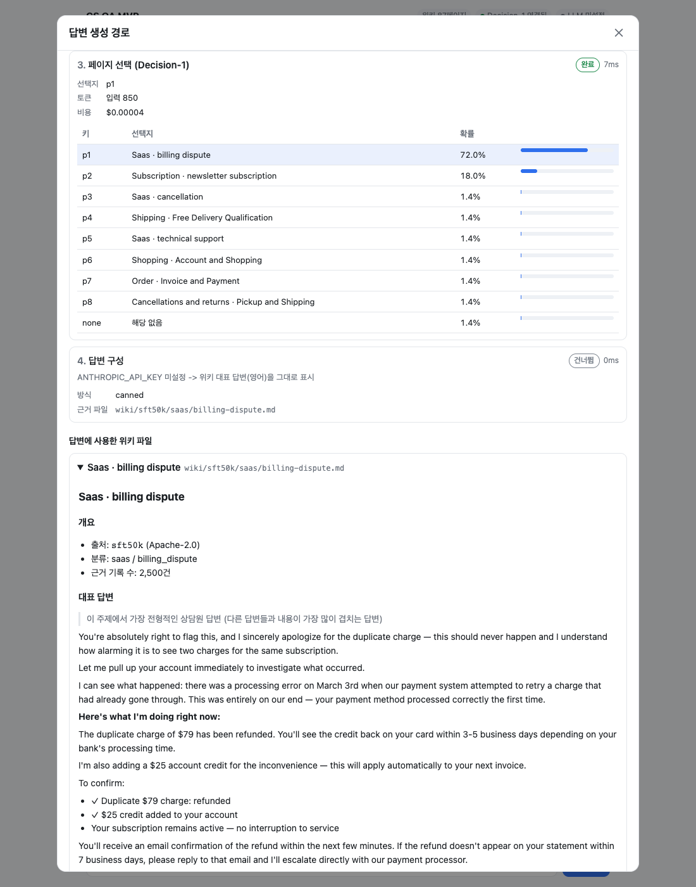

# cs-qa-mvp

과거 CS 문의·답변을 주제별 위키로 정리해 두고, 고객 질문이 들어오면 **위키 검색 → 판단 모델(TypeSafe Jev 또는 Microsoft-Decision-1)로 페이지 선택 → LLM(OpenAI 기본, Claude 선택)으로 답변 생성**하는 CS 자동응답 챗봇 MVP입니다.

판단 모델은 텍스트를 생성하지 않고 선택지별 확률만 돌려주는 싸고 빠른 모델(System One)입니다. LLM 앞단에서 질문을 걸러, 맞는 위키 페이지가 없거나 확신이 낮으면 LLM을 호출하지 않고 상담원 연결로 보냅니다.

답변 말풍선을 누르면 어떤 파일을 어떤 경로로 찾았고, 왜 그 파일을 골랐고, 답을 어떻게 구성했는지와 단계별 비용·지연 시간을 모달에서 볼 수 있습니다.



## 빠른 시작

**필요한 것:** Python 3.10 이상. macOS 기본 `python3`는 3.9라서 쓸 수 없으니 `brew install python@3.13` 등으로 설치하세요.

### 1. 설치

```bash
git clone https://github.com/JK-Kim4/cs-qa-mvp.git && cd cs-qa-mvp
make setup      # .venv 생성 + 의존성 설치
```

### 2. 키 설정 (`.env`)

```bash
cp .env.example .env
```

`.env`를 열어 쓸 키만 채웁니다. `.env`는 `.gitignore`에 들어 있어 커밋되지 않습니다. **키는 모두 선택 사항이라 비워 둬도 앱은 실행됩니다.** 키가 없는 단계는 건너뛰고 그 이유가 상세 모달에 표시됩니다.

최소 구성 예시 (OpenAI + OpenRouter의 Jev):

```bash
# 답변 생성 LLM
OPENAI_API_KEY=sk-proj-...

# 판단 모델: 아래 셋 중 하나만 채우면 그 구현체를 자동으로 씁니다
OPENROUTER_API_KEY=sk-or-v1-...     # TypeSafe Jev via OpenRouter (가입 즉시 사용 가능)
# TYPESAFE_API_KEY=...              # TypeSafe Jev 직접 호출
# DECISION_ENDPOINT=... / DECISION_DEPLOYMENT=... / DECISION_API_KEY=...   # Microsoft-Decision-1
```

| 단계 | 키 | 발급 |
|---|---|---|
| 답변 생성·검색어 변환 (LLM) | `OPENAI_API_KEY` 또는 `ANTHROPIC_API_KEY` | [OpenAI](https://platform.openai.com/api-keys) / [Claude Console](https://console.anthropic.com/) |
| 판단 모델 – Jev via OpenRouter | `OPENROUTER_API_KEY` | [OpenRouter Keys](https://openrouter.ai/keys) |
| 판단 모델 – Jev 직접 | `TYPESAFE_API_KEY` | [TypeSafe Console](https://console.typesafe.ai) |
| 판단 모델 – Decision-1 | `DECISION_ENDPOINT`, `DECISION_DEPLOYMENT`, `DECISION_API_KEY` | [Microsoft Foundry](https://ai.azure.com) (할당량 승인 필요, 아래 참고) |

셸에서 `export`한 환경변수가 `.env`보다 우선합니다. 키를 바꾼 뒤에는 서버를 재시작하세요.

### 3. 실행

```bash
make run        # http://localhost:8000
```

`make`가 없다면 같은 일을 직접 실행하면 됩니다.

```bash
python3.13 -m venv .venv
.venv/bin/pip install -r requirements.txt
.venv/bin/uvicorn app.main:app --reload --port 8000
```

### 4. 어떤 구현체로 떴는지 확인

앱은 **시작할 때 한 번** 설정을 읽어 LLM과 판단 모델 구현체를 고르고, 서버 로그에 남깁니다.

```
INFO:     LLM: openai / gpt-5-mini
INFO:     판단 모델: Jev via OpenRouter (typesafe/jev-1.13) (자동 선택: openrouter 키가 설정됨)
```

같은 내용을 화면 상단 칩과 `GET /api/status`에서도 볼 수 있습니다.

```json
{"llm": {"enabled": true, "provider": "openai", "model": "gpt-5-mini"},
 "decision": {"enabled": true, "provider": "openrouter", "label": "Jev via OpenRouter (typesafe/jev-1.13)", "reason": "자동 선택: openrouter 키가 설정됨"}}
```

### 5. 구현체 바꾸기

`.env`에서 아래 값을 바꾸고 서버를 재시작합니다.

```bash
LLM_PROVIDER=anthropic          # openai(기본) | anthropic
DECISION_PROVIDER=azure         # typesafe | openrouter | azure. 비우면 키가 있는 첫 구현체를 typesafe → openrouter → azure 순으로 자동 선택
```

`DECISION_PROVIDER`를 지정했는데 해당 키가 없으면 판단 단계를 건너뛰고(BM25 1위 페이지 사용), 시작 로그와 상세 모달에 `DECISION_PROVIDER=azure 인데 DECISION_API_KEY 미설정`처럼 이유를 남깁니다. 같은 질문 세트를 구현체별로 돌려 보면 상세 모달의 단계별 비용·지연 시간으로 결과와 비용을 비교할 수 있습니다.

### 6. 비교 모드 (판단 모델 경로 vs 바이패스)

화면 오른쪽 위 **비교 모드** 토글을 켜고 질문하면, 같은 질문을 두 경로로 동시에 처리해 나란히 보여 줍니다. 토글 상태는 브라우저에 기억됩니다.

| 경로 | 처리 |
|---|---|
| **A · 판단 모델** | 검색 후보 → 판단 모델(Jev 등)이 페이지 선택 또는 '해당 없음' → LLM 답변 또는 상담원 연결 |
| **B · 바이패스** | 검색 후보 → 판단 모델 없이 BM25 1위 페이지 → LLM 답변 |

- 검색어 변환과 위키 검색은 **한 번만 실행해 두 경로가 같은 결과를 공유**합니다. 그래서 두 결과의 차이는 판단 단계에서만 생깁니다.
- 두 경로는 **동시에** 실행됩니다. 한쪽이 먼저 실행되어 생기는 지연이나 캐시 이점이 없습니다.
- 각 결과의 비용·소요 시간에는 공통 단계(검색어 변환 등)도 포함되어, 그 경로를 단독으로 운영할 때의 값과 같습니다. 카드 아래에 답변 방식, 근거 페이지, 비용, 시간의 차이가 한 줄로 요약되고, 카드를 누르면 경로별 상세 모달이 열립니다.
- 앱 자체에는 답변 캐시가 없습니다. LLM 제공사의 프롬프트 캐시가 적중하면 상세 모달의 토큰 항목에 `(캐시 N)`으로 표시되며, 비용은 캐시 할인 없이 정가로 계산해 두 경로를 같은 기준으로 비교합니다. LLM 답변 문구는 같은 입력이어도 실행마다 조금씩 달라질 수 있습니다.
- API로는 `POST /api/chat`에 `{"question": "...", "compare": true}`를 보내면 `{"with_decision": ..., "bypass": ...}`를 받습니다.

### 7. 데이터 가이드와 사용법 안내

- **데이터 가이드:** 상단 **데이터 가이드 · 87주제** 버튼을 누르면 어떤 데이터셋이 들어 있고 어떤 주제로 질문할 수 있는지 보여 주는 모달이 열립니다. 데이터셋 탭(전체/bitext/ecommerce/sft50k), 주제 검색, 그룹별 주제 칩, 선택한 주제의 근거 기록 수·예시 질문·대표 답변 앞부분·위키 본문을 볼 수 있고, 예시 질문을 누르면 모달이 닫히며 그 질문이 바로 전송됩니다. 선택한 데이터셋에 검색어가 없으면 전체에서 찾아 줍니다. 데이터는 `GET /api/guide`가 위키에서 만들어 돌려줍니다.
- **사용법 안내:** 브라우저로 처음 접속하면 질문 입력, 데이터 가이드, 비교 모드, 연결 상태, 답변 상세 보기를 차례로 짚어 주는 6단계 안내가 뜹니다. 끝내거나 건너뛰면 쿠키(`cs_qa_tour`, 1년)에 기억해 다시 뜨지 않고, 상단 **?** 버튼으로 언제든 다시 볼 수 있습니다.

### 8. 이어지는 질문 (대화 문맥)

채팅 화면은 질문과 함께 최근 대화를 보내서 "발송해 주세요"처럼 앞 대화에 기대는 질문도 이해하게 합니다.

- 서버는 최근 6개 메시지만 씁니다 (`app/pipeline.py`의 `HISTORY_MAX_MESSAGES`).
- 검색어 변환에는 그중 고객 질문만, 답변 생성에는 대화 전체를 넘깁니다. 이전 챗봇 답변은 500자까지만 넘깁니다.
- 이전 질문이 있으면 영어 질문도 검색어 변환을 거칩니다.
- 입력 토큰이 늘어납니다. 상세 보기의 검색어 변환·답변 구성 단계에서 반영한 이전 질문과 토큰을 확인할 수 있습니다.
- API로는 `POST /api/chat`에 `{"question": "...", "history": [{"role": "user", "text": "..."}, {"role": "bot", "text": "..."}]}`를 보냅니다.

### 9. 상담 종료 → 노션 티켓

채팅 화면의 **상담 종료** 버튼을 누르면 지금까지의 대화를 노션 **CS 처리 보드**에 카드 한 장으로 만듭니다.

1. `.env`에 `NOTION_TOKEN`과 `NOTION_DATA_SOURCE_ID`를 넣고 서버를 재시작합니다. `scripts/setup.sh`로도 입력할 수 있습니다. 토큰의 통합(연결)이 보드가 있는 노션 페이지에 연결돼 있어야 합니다.
2. 상단 상태에 `노션 연결됨`이 보이면 준비된 것입니다.
3. 질문을 하나 이상 주고받은 뒤 **상담 종료**를 누르면 채팅에 CS 번호와 노션 링크가 표시되고, 새 상담이 시작됩니다.
4. 챗봇 답변이 **상담원 연결**로 분류되면 버튼을 누르지 않아도 그때까지의 대화로 티켓을 바로 만들고 상담을 끝냅니다. 비교 모드에서는 판단 모델 경로(A)의 결과를 기준으로 합니다. 자동 생성이 실패하면 대화가 남아 있으니 **상담 종료**로 다시 시도할 수 있습니다.

카드에 들어가는 값은 다음과 같습니다.

| 속성 | 값 |
|---|---|
| CS 요약 | LLM이 대화를 한 줄로 요약 (LLM이 없거나 실패하면 첫 질문) |
| 카테고리, 우선순위 | LLM이 보드의 선택지 중에서 고름. 보드에 없는 값을 고르면 `기타`, `보통`으로 바꾸고 경고를 표시 |
| 단계 | `등록` |
| 접수 채널 | `서비스 채팅` (보드에 없던 선택지라 첫 카드를 만들 때 노션이 추가) |
| 본문 | 상담 정리(LLM), 대화 기록(답변마다 위키 근거 답변 / 상담원 연결 안내 등 표시) |

CS 번호와 등록일시는 노션이 자동으로 채우고, 담당자와 요청자 연락처는 비워 둡니다. API로는 `POST /api/tickets`에 `{"messages": [{"role": "user", "text": "..."}, {"role": "bot", "text": "...", "route": "generate"}]}`를 보냅니다.

## API 키 상세

### LLM API 키 (OpenAI 또는 Claude)

`LLM_PROVIDER`로 고릅니다. 기본값은 `openai`이고, 고른 provider의 키만 있으면 됩니다.

| `LLM_PROVIDER` | 키 | 기본 모델 | 발급 |
|---|---|---|---|
| `openai` (기본) | `OPENAI_API_KEY` | `gpt-5-mini` | [OpenAI Platform](https://platform.openai.com/api-keys) |
| `anthropic` | `ANTHROPIC_API_KEY` | `claude-opus-5-5` | [Claude Console](https://console.anthropic.com/) |

모델은 `LLM_MODEL`로 바꿀 수 있습니다(예: `gpt-5`, `gpt-5-nano`, `claude-sonnet-5-5`). OpenAI는 Responses API를 쓰고 `LLM_EFFORT`를 `reasoning.effort`로 넘기므로, 모델이 지원하지 않는 effort 값(`gpt-5-mini`의 `xhigh`/`max` 등)을 주면 API 오류가 납니다.

LLM은 두 곳에서 쓰입니다.

1. **검색어 변환:** 위키가 영어라서, 한국어 질문을 영어 검색어로 바꿉니다.
2. **답변 생성:** 선택된 위키 페이지만 근거로, 고객이 쓴 언어로 답합니다.

Claude provider에서는 안전 분류기가 요청을 거절하면 서버가 권장 모델로 자동 재시도하도록 `fallbacks: "default"`를 켜 두었습니다(`server-side-fallback-2026-07-01` 베타).

### 판단 모델 (System One): TypeSafe Jev 또는 Microsoft-Decision-1

검색 후보 중 어느 페이지로 답할지(또는 '해당 없음')를 텍스트 생성 없이 선택지별 확률로 고르는 단계입니다. LLM 앞단에서 이 단계가 질문을 걸러서, 맞는 페이지가 없거나 확신이 낮으면 LLM을 호출하지 않고 상담원 연결로 보냅니다.

`app/decision.py`의 `DecisionModel` 인터페이스(`label`, `choose`, `cost`)를 구현체 셋이 구현합니다. 앱이 시작할 때 설정을 보고 하나를 골라 끝까지 씁니다.

| `DECISION_PROVIDER` | 구현체 | 필요한 키 | 엔드포인트 |
|---|---|---|---|
| `typesafe` | `TypeSafeJev` | `TYPESAFE_API_KEY` (모델 `TYPESAFE_MODEL`, 기본 `jev-latest`) | `POST https://api.typesafe.ai/v1/systemone` |
| `openrouter` | `OpenRouterJev` | `OPENROUTER_API_KEY` (모델 `OPENROUTER_DECISION_MODEL`, 기본 `typesafe/jev-1.13`) | `POST https://openrouter.ai/api/alpha/decisions` |
| `azure` | `AzureDecision1` | `DECISION_ENDPOINT`, `DECISION_DEPLOYMENT`, `DECISION_API_KEY` | `POST {endpoint}/providers/microsoft/v1/systemone` |

- `DECISION_PROVIDER`를 비워 두면 키가 모두 설정된 첫 구현체를 `typesafe → openrouter → azure` 순서로 고릅니다.
- `DECISION_PROVIDER`를 지정했는데 그 키가 없으면 판단 단계를 건너뛰고(BM25 1위 사용), 이유를 상세 모달과 서버 시작 로그에 남깁니다.
- 어떤 구현체로 떴는지는 서버 시작 로그(`판단 모델: ...`)와 화면 상단 칩, `/api/status`에서 확인할 수 있습니다.
- 비용은 응답에 실제 청구액(`usage.cost`, OpenRouter)이 있으면 그 값을, 없으면 공개 단가($0.042/100만 입력 토큰)로 추정합니다.
- 새 구현체를 추가하려면 `DecisionModel`을 상속해 `name`, `env`, `from_settings`, `label`, `url`, `headers`를 정의하고 `PROVIDERS`에 넣으면 됩니다.

#### Microsoft-Decision-1 (Microsoft Foundry)

1. [Foundry 포털](https://ai.azure.com) → 프로젝트 → **모델** → `Microsoft-Decision-1` → **배포**. 배포 유형은 **데이터 영역 표준**(사용량 기반 과금)을 고릅니다.
   - "부족한 할당량"이 뜨면 **관리 → 할당량**에서 `모두 표시`를 켜고 확인합니다. 0이면 **할당량 요청**으로 신청합니다(Quota Type: Model Deployment, Model Type: Azure Direct Model). 승인까지 영업일 1~2일 걸리고 거절될 수 있습니다.
2. 배포 상세 화면에서 **리소스 엔드포인트, 배포 이름, API 키**를 복사해 `DECISION_ENDPOINT`, `DECISION_DEPLOYMENT`, `DECISION_API_KEY`에 넣습니다.

앱은 `POST {DECISION_ENDPOINT}/providers/microsoft/v1/systemone`을 `api-key` 헤더로 호출합니다. 자세한 내용은 [공식 문서](https://learn.microsoft.com/azure/foundry/foundry-models/how-to/use-foundry-models-microsoft-decision)를 참고하세요.

## 동작 방식

```
질문
 │
 ├─ 1. 검색어 변환   한국어면 LLM이 영어 검색어로 변환 (영어면 건너뜀)
 ├─ 2. 위키 검색     BM25 키워드 검색으로 후보 페이지 8개 추림
 ├─ 3. 페이지 선택   판단 모델(Jev 또는 Decision-1)이 후보 + '해당 없음' 중 하나를 확률과 함께 선택
 └─ 4. 답변 구성     아래 중 하나
        ├─ LLM 생성       선택 페이지(필요하면 2순위까지)를 근거로 LLM이 답변
        ├─ 위키 답변 그대로  확률 ≥ DIRECT_ANSWER_THRESHOLD 이면 LLM 호출 없이 대표 답변 발송 (기본 꺼짐)
        └─ 상담원 연결     '해당 없음'이거나 확률 < MIN_CONFIDENCE 이면 LLM 호출 없이 연결 안내
```

**키가 없을 때의 동작:**

| 상황 | 동작 |
|---|---|
| 판단 모델 키 없음 | BM25 1위 페이지를 그대로 사용합니다. **"해당 없음" 판정이 없어서 엉뚱한 질문에도 아무 페이지로 답합니다.** |
| LLM 키 없음 | 위키 대표 답변(영어 원문)을 그대로 보여 줍니다. 한국어 질문은 검색어 변환을 못 해서 대부분 상담원 연결로 빠집니다. |
| API 호출 실패 | 위 동작으로 대체하고, 모달 상단에 경고를 표시합니다. |

### 상세 모달에서 볼 수 있는 것

- 답변 방식, 총 소요 시간, 추정 비용, 판단 근거
- 단계별 상태(완료/건너뜀/오류), 소요 시간, 건너뛴 이유
- 검색 후보 페이지와 BM25 점수 (제목을 누르면 위키 본문 미리보기)
- 판단 모델(Jev 또는 Decision-1)이 매긴 선택지별 확률
- LLM 모델, effort, 근거 파일, 토큰 수, 비용
- 답변에 실제로 사용한 위키 파일 전문
- 원본 trace JSON

## 환경변수

| 이름 | 기본값 | 설명 |
|---|---|---|
| `LLM_PROVIDER` | `openai` | `openai` / `anthropic` |
| `OPENAI_API_KEY` | (없음) | OpenAI API 키 |
| `ANTHROPIC_API_KEY` | (없음) | Claude API 키 |
| `LLM_MODEL` | `gpt-5-mini` / `claude-opus-5-5` | 답변 생성 모델 (provider별 기본값) |
| `LLM_EFFORT` | `medium` | `low` / `medium` / `high` / `xhigh` / `max` |
| `REWRITE_MODEL` | `LLM_MODEL`과 같음 | 검색어 변환 모델 (항상 effort `low`) |
| `DECISION_PROVIDER` | 자동 | `typesafe` / `openrouter` / `azure` |
| `TYPESAFE_API_KEY` | (없음) | TypeSafe 키 (Jev 직접 호출) |
| `TYPESAFE_MODEL` | `jev-latest` | TypeSafe 모델 ID |
| `OPENROUTER_API_KEY` | (없음) | OpenRouter 키 (Jev) |
| `OPENROUTER_DECISION_MODEL` | `typesafe/jev-1.13` | OpenRouter 판단 모델 ID |
| `DECISION_ENDPOINT` | (없음) | Foundry 리소스 엔드포인트 |
| `DECISION_DEPLOYMENT` | (없음) | Foundry 배포 이름 |
| `DECISION_API_KEY` | (없음) | Foundry API 키 |
| `SEARCH_TOP_K` | `8` | Decision-1에 넘길 후보 수 |
| `MIN_CONFIDENCE` | `0.5` | 이보다 낮으면 상담원 연결 |
| `SECOND_PAGE_MIN` | `0.2` | 2순위 확률이 이 이상이면 근거로 함께 전달 |
| `DIRECT_ANSWER_THRESHOLD` | (꺼짐) | 이 확률 이상이면 LLM 없이 대표 답변 발송 |
| `WIKI_DIR` | `wiki/` | 위키 위치 |
| `NOTION_TOKEN` | (없음) | 노션 통합 토큰 (상담 종료 시 티켓 생성) |
| `NOTION_DATA_SOURCE_ID` | (없음) | 티켓을 만들 CS 처리 보드의 데이터 소스 ID |

**임계값은 추정치입니다.** 실제 CS 데이터로 정답률을 재 보고 조정하세요.

## 위키와 데이터

`wiki/`에는 이미 생성된 페이지 87개가 들어 있어서 바로 실행할 수 있습니다. 주제 하나당 페이지 하나이고, 각 페이지에는 대표 답변, 질문 예시 20개, 답변 사례 3개가 들어 있습니다. 검색용 질문 예시(주제당 최대 400개)는 `wiki/_index.jsonl`에 따로 저장돼 있습니다.

| 출처 | 페이지 | 라이선스 | 내용 |
|---|---|---|---|
| bitext | 27 | CDLA-Sharing-1.0 | 주문, 환불, 계정 등 일반 CS intent |
| sft50k | 20 | Apache-2.0 | 업종별(이커머스, SaaS, 은행, 여행 등) 이슈 |
| ecommerce | 40 | MIT | 이커머스 이슈별 요약 질문과 해결책 |

원본에서 다시 만들려면 다음을 실행합니다.

```bash
make data    # Hugging Face에서 6개 데이터셋 다운로드(약 400MB) → data/normalized/*.jsonl (약 1.1GB)
make wiki    # data/normalized → wiki/
```

`data/`는 커밋하지 않습니다. 정규화 단계에는 twitter(실제 기업 트위터 CS 77만 건)와 tickets(IT 티켓)도 포함되지만, **비상업(NC) 라이선스라 위키에는 넣지 않습니다.**

## 테스트

```bash
make test
```

외부 API 대신 가짜 LLM과 가짜 판단 모델을 써서 라우팅 분기(상담원 연결, 낮은 확신, 2순위 페이지 포함, 직접 답변, API 실패 시 대체)와 HTTP API를 검증합니다.

## 구조

```
app/
  main.py       FastAPI 앱, /api/chat · /api/tickets · /api/status · /api/wiki/{id}
  ticket.py     상담 종료 → 대화 요약·분류 → 노션 CS 처리 보드에 카드 생성
  pipeline.py   검색어 변환 → 검색 → 선택 → 답변, 단계별 trace 기록
  wiki.py       위키 로딩, BM25 검색
  decision.py   판단 모델 인터페이스(DecisionModel)와 구현체(TypeSafeJev, OpenRouterJev, AzureDecision1)
  llm.py        OpenAI/Claude 클라이언트, 프롬프트, 비용 추정
  config.py     환경변수
static/         채팅 UI (빌드 단계 없는 HTML/CSS/JS)
scripts/        download.sh → normalize.py → build_wiki.py
wiki/           생성된 위키 (커밋됨)
tests/
```

## 한계

- **위키가 영어입니다.** 한국어 질문은 LLM으로 검색어를 변환해야 검색이 됩니다. 실제 서비스에서는 한국어 CS 기록으로 위키를 만들어야 합니다.
- **sft50k 대표 답변은 특정 고객 건의 기록입니다.** "$79 환불 완료" 같은 내용이 들어 있습니다. 프롬프트로 그대로 옮기지 못하게 막아 두었지만, LLM 키 없이 원문을 보여 줄 때는 앞에 경고 문구를 붙입니다.
- **대화 맥락이 없습니다.** 질문 하나하나를 독립적으로 처리합니다.
- **판단 모델의 확률은 이 데이터로 검증되지 않았습니다.** Jev와 Decision-1 모두 최근 출시된 모델이라, 실제 데이터로 정답률을 측정한 뒤 `MIN_CONFIDENCE` 등 임계값을 정해야 합니다.
- 비용은 응답에 실제 청구액이 오면(OpenRouter `usage.cost`) 그 값, 아니면 공개 단가 기준 추정값이며 실제 청구액과 다를 수 있습니다.
